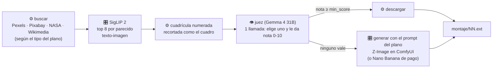

# Arquitectura del pipeline

Cómo está hecho el grafo de LangGraph (`src/graph/build.py`): qué es cada nodo, si usa un LLM y cómo lo usa, qué recibe, qué hace y qué deja.

---

## Qué tipo de pieza es cada nodo

El pipeline es un **workflow**, no un sistema de agentes. El orden de los pasos lo fija el grafo y las decisiones de rumbo las toma una persona en las pausas. **Ningún nodo es un agente**: en ninguno el modelo elige herramientas ni decide cuántas vueltas dar.

| Símbolo | Tipo | Qué significa |
|---|---|---|
| 🤖 | **Cadena LLM** | `hub.chain(prompt, schema)`: un prompt de `src/prompts/` + un esquema Pydantic → el modelo devuelve **JSON validado**. El código decide cuántas llamadas se hacen, con qué texto y qué se hace con la respuesta (buscar, leer, descargar...). |
| 👁️ | **Cadena LLM con visión** | Igual, pero el modelo recibe además una imagen (`hub.look`). |
| ⏸️ | **Pausa humana** | `ask_approval` → *interrupt* de LangGraph. El grafo se guarda en `checkpoints.sqlite` y espera tu decisión: `[y]` aprobar, `[e]` editar, `[n]` rechazar con motivo. Según la respuesta, el nodo elige el siguiente con `Command(goto=...)`. |
| ⚙️ | **Código** | Python sin ningún modelo. |
| 🎛️ | **Worker de GPU** | Un modelo de IA local que no es un LLM (voz, Whisper, SigLIP, profundidad, imágenes). Corre en un proceso aparte (`.venv-tts` o ComfyUI) y libera la VRAM al terminar. |

> **¿Por qué no agentes?** Con un esquema fijo y el código al mando, cada paso es predecible, barato y se puede editar a mano (cada nodo deja su `.json`). Un agente podría saltarse la investigación, inventar fuentes o gastar llamadas sin límite.

---

## El grafo

```mermaid
flowchart TD
    START([run_pipeline.py]) -->|sin --topic| find_topics
    START -->|--topic| research

    subgraph TEXTO["Fase de texto (LLM en la nube)"]
        find_topics["🤖 find_topics<br/>puntúa temas de los feeds"]
        choose_topic{{"⏸️ choose_topic"}}
        research["🤖 research<br/>búsquedas → hechos con fuente"]
        angles["🤖 angles<br/>3 enfoques"]
        choose_angle{{"⏸️ choose_angle"}}
        outline["🤖 outline<br/>secciones del vídeo"]
        approve_outline{{"⏸️ approve_outline"}}
        deep_research["🤖 deep_research<br/>contexto por sección"]
        review_research{{"⏸️ review_research"}}
        write_script["🤖 write_script<br/>plan + escenas"]
        review_script["🤖 review_script<br/>editor"]
        choose_script{{"⏸️ choose_script"}}
        manual_script{{"⏸️ manual_script<br/>tu guion"}}
    end

    find_topics --> choose_topic
    choose_topic -->|"[y] / [e] número"| research
    choose_topic -->|"[n] otros"| find_topics
    choose_topic -->|"[n] x 3 5 (descarta)"| choose_topic
    research --> angles --> choose_angle
    choose_angle -->|"[n] + motivo"| angles
    choose_angle -->|"[y] / [e]"| outline
    outline --> approve_outline
    approve_outline -->|"[n] + motivo"| outline
    approve_outline -->|"secciones con preguntas"| deep_research
    approve_outline -->|"sin preguntas"| write_script
    approve_outline -->|"--manual"| manual_script
    deep_research --> review_research
    review_research -->|"[n] tus enlaces"| deep_research
    review_research -->|"[y]"| write_script
    write_script --> review_script
    review_script -->|"algo grave<br/>(máx. max_revisions)"| write_script
    review_script --> choose_script
    choose_script -->|"[n] + motivo"| write_script
    choose_script -->|"[n] + Enter"| manual_script
    choose_script -->|"[y]"| unload_llm
    manual_script -->|"[y] guion.md OK"| unload_llm

    subgraph MEDIOS["Fase de medios (GPU local, un modelo cada vez)"]
        unload_llm["⚙️ unload_llm"]
        voice["🎛️ voice<br/>Qwen3-TTS"]
        align["🎛️ align<br/>Whisper"]
        brief["🤖 brief<br/>universo visual"]
        beats["🤖 beats<br/>qué se ve y desde qué palabra"]
        visuals["👁️🎛️ visuals<br/>buscar, filtrar, juzgar, generar"]
        review_visuals{{"⏸️ review_visuals<br/>montaje/"}}
        assemble["🎛️⚙️ assemble<br/>ffmpeg + 2.5D"]
    end

    unload_llm --> voice --> align --> brief --> beats --> visuals --> review_visuals
    review_visuals -->|"[y]"| assemble --> FIN([vídeo .mp4])
    review_visuals -->|"[n]"| PARA([para; luego --redo assemble])

    FIN -.-> prepare["🤖 prepare_upload.py<br/>título, descripción, miniatura"]
    prepare -.-> upload["⚙️ upload_youtube.py"]

    classDef llm fill:#dbeafe,stroke:#2563eb,color:#111
    classDef pause fill:#fef3c7,stroke:#d97706,color:#111
    classDef code fill:#e5e7eb,stroke:#6b7280,color:#111
    classDef gpu fill:#dcfce7,stroke:#16a34a,color:#111
    class find_topics,research,angles,outline,deep_research,write_script,review_script,brief,beats,prepare llm
    class choose_topic,choose_angle,approve_outline,review_research,choose_script,manual_script,review_visuals pause
    class unload_llm,upload code
    class voice,align,visuals,assemble gpu
```



Leyenda de colores: azul = cadena LLM · amarillo = pausa · verde = GPU local · gris = código. Las líneas discontinuas son scripts que se lanzan a mano, fuera del grafo.

---

## Nodo a nodo

### Elegir el tema

| | **find_topics** 🤖 | **choose_topic** ⏸️ |
|---|---|---|
| Cuándo | Solo si el run empieza sin `--topic` | Tras `find_topics` |
| Recibe | Los feeds de `topics.feeds` y `data/temas/registro.json` | Los temas candidatos |
| Hace | ⚙️ Lee los feeds y quita lo ya visto. 🤖 **1 llamada** (`prompts/topics.md`): agrupa las entradas que cuentan lo mismo y las puntúa para el canal | `[y]` el 1 · `[e]` otro número · `[n] x 3 5` descarta para siempre · `[n]` otros temas |
| Deja | `data/temas/<fecha>.md`, temas `propuesto` en el registro | `topic`, `urls`, `notes` (el datazo), `video_type` y `format` en el estado; el tema pasa a `en_curso` |

### Investigar

**research** 🤖 · `prompts/research_queries.md` + `research_facts.md`

| | |
|---|---|
| Recibe | Tema, tus notas y tus URLs |
| Hace | 🤖 **1 llamada** que decide news o explainer, escribe 4 búsquedas y elige artículos de Wikipedia. ⚙️ Busca (Tavily o DuckDuckGo), descarga y limpia los textos (trafilatura) y salta `skip_domains`. 🤖 **1 llamada por texto** (4–6) que saca los hechos de ese texto solo, así cada hecho conserva su fuente |
| Deja | `sources`, `facts` y `<run>/research/*.txt` |

**deep_research** 🤖 + **review_research** ⏸️ · `prompts/deep_research_searches.md` + `deep_research_facts.md`

| | |
|---|---|
| Cuándo | Tras aprobar el esquema, si alguna sección tiene `questions` (y `research.deep` está activo para el formato) |
| Hace | Por cada sección con preguntas: 🤖 **1 llamada** que dice dónde buscar (web + Wikipedia); ⚙️ lee hasta 4 textos; 🤖 **1 llamada por texto** que saca los hechos de esa sección |
| Pausa | Muestra los hechos por sección y cuánto durará el vídeo (una sección no puede durar más de lo que dan sus hechos). `[y]` sigue · `[n] 4 https://...` lee tus enlaces para esa sección y vuelve a preguntar |
| Deja | Más `facts` (con `section`) y `<run>/research/s<n>_<m>.txt` |

### Construir la historia

| | **angles** 🤖 → **choose_angle** ⏸️ | **outline** 🤖 → **approve_outline** ⏸️ |
|---|---|---|
| Recibe | Hechos | Hechos + el enfoque elegido |
| Hace | 🤖 **1 llamada**: 3 enfoques distintos (pregunta, gancho, por qué engancha) y el más fuerte | 🤖 **1 llamada**: título, hilo y secciones (papel, emoción, hechos y preguntas por averiguar). ⚙️ El código pone las palabras de cada sección |
| Pausa | `[y]` el recomendado · `[e]` otro o el tuyo · `[n]` + motivo: 3 nuevos | `[y]` sigue (vuelve a leer `outline.json`) · `[n]` + motivo: se rehace |
| Deja | `angles.md` / `angles.json` | `outline.md` / `outline.json` |

### Escribir y revisar el guion

**write_script** 🤖 · `prompts/write_script.md`

| | |
|---|---|
| Recibe | Esquema, enfoque, hechos y, si es una reescritura, la versión anterior con lo que hay que cambiar |
| Hace | **Short:** 🤖 **1 llamada** con el guion entero. **Largo:** 🤖 **1 llamada por sección** (4–6); cada una ve el esquema, sus hechos, el final de la sección anterior y lo ya contado. Primero escribe un **plan** de tensión y luego las escenas. ⚙️ Comprueba longitud y repeticiones; si fallan, 🤖 **1 llamada más** diciendo qué arreglar |
| Deja | `script` (+ `script.md` / `script.json`) y `plan_guion.md` |

**review_script** 🤖 · `prompts/review_script.md`

| | |
|---|---|
| Recibe | Guion + esquema + hechos (+ lo que se pidió en la última reescritura) |
| Hace | 🤖 **1 llamada**: un editor devuelve `issues` (graves o no, por escena) y `dubious` (hechos que parecen un error del artículo) |
| Decide | Hay algo grave y quedan revisiones → vuelve a `write_script` con las notas (en un largo, solo esas secciones). Si no → `choose_script` |

**choose_script** ⏸️ → **manual_script** ⏸️

| | |
|---|---|
| choose_script | `[y]` sigue · `[n]` + motivo: reescribe · `[n]` + Enter: escribes tú |
| manual_script | ⚙️ Prepara `<run>/manual/guion.md` (y `visuales/`), espera tu `[y]`, lo valida (`graph/manual.py`) y lo convierte en `script` + `manual_visuals` (tus marcas `[archivo]`) |

### Pasar a medios

**unload_llm** ⚙️ hace `lms unload --all` (solo si hay un modelo local en LM Studio) para dejar la GPU libre.

**voice** 🎛️ (Qwen3-TTS, `.venv-tts`)

| | |
|---|---|
| Hace | Un solo trabajo para todas las escenas con la voz de `assets/voice_reference.wav` (semilla fija). ⚙️ Corta el silencio final y normaliza |
| Deja | `audio[escena] = {path, duration}` y `<run>/audio/` |

**align** 🎛️ (Whisper large-v3-turbo)

| | |
|---|---|
| Hace | Transcribe cada escena con tiempos por palabra. ⚙️ Empareja sus palabras con las del guion (`difflib`) e interpola las que Whisper escribe distinto |
| Deja | `audio[escena].words`: la palabra i del guion con su `start`/`end` |

### Decidir qué se ve

| | **brief** 🤖 · `prompts/brief.md` | **beats** 🤖 · `prompts/beats.md` |
|---|---|---|
| Recibe | El guion final | Guion + duraciones + brief |
| Hace | 🤖 **1 llamada**: universo visual del vídeo (cosas filmables), lo que nunca debe verse, cómo se enseña cada metáfora y el estilo de las imágenes | 🤖 **1 llamada cada 8 escenas** (2–5 por vídeo; las escenas que se salte, otra vez): ideas por escena, cada una con su tipo (`entity`/`generic`/`data`/`source`/`abstract`) y sus planos (qué tiene que verse, búsquedas en inglés, prompt de imagen). ⚙️ Coloca cada idea en su palabra con los tiempos de `align` y une o parte planos según `beat_seconds` |
| Deja | `brief.json` | `beats.json`, `manual/prompts_imagenes.md` y `plan_visual.json` |

### Encontrar o generar cada plano

**visuals** 👁️🎛️ · `prompts/visual_choice.md`. Por cada plano:



- **Llamadas:** 👁️ **1 por plano**, más alguna extra en los planos largos: en vídeos largos, una foto no pasa de 5 s, así que se busca primero un vídeo y, si no hay, otra imagen buena o la misma generada con otro encuadre.
- **Deja:** `visuals`, `visual_extras`, `<run>/visuals/` (con `choices.json`: qué se eligió y por qué) y `<run>/montaje/` en orden con `lista.md`.

**review_visuals** ⏸️

| | |
|---|---|
| Hace | Te deja `montaje/` para sustituir, quitar o añadir archivos (`05.jpg`, `05b.mp4`) y poner `musica.mp3` |
| Decide | `[y]` monta exactamente lo que hay, sin juez · `[n]` para (luego `--redo assemble`) |

### Montar

**assemble** ⚙️🎛️ (ffmpeg + Depth Anything)

| | |
|---|---|
| Hace | Un segmento por plano desde su palabra. Vídeos recortados y, si hace falta, ralentizados. Fotos con movimiento de cámara y 2.5D (🎛️ profundidad). Fundido entre escenas. Voz normalizada a −14 LUFS + música a nivel fijo. Subtítulos ASS quemados. `h264_nvenc` |
| Deja | `<run>/<yyyymmdd>_<tema>.mp4` y `<run>/segments/` |

### Fuera del grafo

| Script | Tipo | Qué hace |
|---|---|---|
| `scripts/prepare_upload.py` | 🤖 **1 llamada** (`prompts/publish.md`) + ⚙️ | Título, resumen, etiquetas y texto de la miniatura; el resto (descripción con fuentes y créditos, `.srt`, miniatura, aviso de IA) lo monta el código |
| `scripts/upload_youtube.py` | ⚙️ | Sube a YouTube, mueve la carpeta a `data/subidos/` y marca el tema como `subido` |
| `scripts/find_topics.py` | 🤖 1 llamada (o ninguna con `--no-llm`) | Lo mismo que `find_topics`, sin empezar un vídeo |
| `scripts/design_voice.py` | 🎛️ | Diseña candidatos de voz con Qwen3-TTS VoiceDesign (una vez) |

---

## Llamadas al LLM por vídeo

| Nodo | Short | Largo |
|---|---|---|
| find_topics | 1 (si no hay `--topic`) | 1 |
| research | 1 + 1 por texto (~5) | 1 + 1 por texto (~7) |
| angles, outline | 1 + 1 | 1 + 1 |
| deep_research | por sección con preguntas: 1 + hasta 4 | ídem (4–6 secciones) |
| write_script | 1 (+1 si falla la longitud) | 1 por sección (+ correcciones) |
| review_script | 1 por revisión (máx. 2) | ídem |
| brief, beats | 1 + 2 | 1 + 3–5 |
| visuals (visión) | 1 por plano (~20–40) | 1 por plano (+ extras) |
| prepare_upload | 1 | 1 |

Todas usan el modelo de su nodo en `config.yaml` (`llm.<nodo>`, que hereda de `llm.default`). Si una falla (sin saldo, 429...), ese nodo pasa a su `fallback` el resto del run.

Una entrada de `llm` no tiene por qué ser un nodo del grafo: es la etiqueta de qué modelo usa una llamada. Las extracciones de hechos de `research` y `deep_research` (una por texto) usan `llm.facts` (Claude Haiku 5.5, mucho más barato), y sus búsquedas, el modelo del nodo (Sonnet). Lo que gasta cada etiqueta queda en `<run>/costes.md`.

---

## El estado que se pasan los nodos

Los nodos no se hablan entre sí: cada uno lee el **estado** (`VideoState`, `src/graph/state.py`) y devuelve solo las claves que cambia. LangGraph lo guarda tras cada paso (`data/checkpoints.sqlite`, un *thread* por run), y por eso:

- un run parado en una pausa o por un error se reanuda con `--resume <run_id>` justo donde estaba;
- `--redo <nodo>` reescribe el estado como si acabara de terminar el nodo anterior y sigue desde ahí (solo nodos de medios: `voice`, `align`, `brief`, `beats`, `visuals`, `assemble`);
- lo que editas a mano (`angles.json`, `outline.json`, `script.json`, `brief.json`, `beats.json`, `montaje/`) se vuelve a leer al aprobar o al rehacer.

```
topic, notes, urls ─► sources, facts ─► angles, angle ─► outline ─► script ─► audio (+ words)
                                                                               │
                              video_path ◄─ montage ◄─ visuals ◄─ beats ◄─ brief
```
